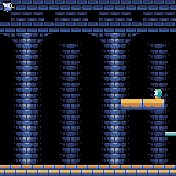
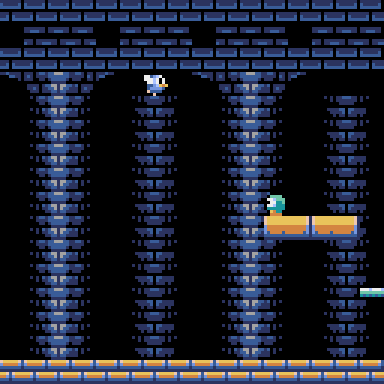

# pyxel-mcp

**Let AI agents play, watch, and measure [Pyxel](https://kitao.dev/pyxel/) games.** pyxel-mcp is an MCP server that runs a Pyxel script headlessly, feeds it scheduled input, stops when a condition holds, and hands back the facts: screenshots, pixel grids, game state, assets, audio, and frame diffs.

[](https://pypi.org/project/pyxel-mcp/)
[](https://pypi.org/project/pyxel-mcp/)
[](https://github.com/kitao/pyxel-mcp/actions/workflows/test.yml)
[](https://github.com/kitao/pyxel-mcp/blob/main/LICENSE)
[](https://registry.modelcontextprotocol.io)

<p align="center">
  
  
</p>
<p align="center"><sub>Both images come from one <code>run</code> call against Pyxel's bundled <code>10_platformer.py</code>: 150 frames, right held from frame 0, jumps scheduled at frames 25, 70, and 110, a <code>video</code> snapshot, and an inline <code>screen_image</code> snapshot.</sub></p>

## Try it

After installing, ask your MCP client to run a bundled game:

> Use pyxel_info to find 10_platformer. Hold KEY_RIGHT for 30 frames and show me the first and last frames.

The agent can use the returned script path, send input on frame 0, and request two inline screenshots. No game window or separate image viewer is needed.

## Install

Register the stdio server with your client:

```bash
claude mcp add --scope user pyxel -- uvx pyxel-mcp
```

```bash
codex mcp add pyxel -- uvx pyxel-mcp
```

```bash
gemini mcp add pyxel uvx pyxel-mcp
```

For Cursor (`~/.cursor/mcp.json`), a project-scoped Claude Code `.mcp.json`, or any other client that reads the common JSON format, add:

```json
{
  "mcpServers": {
    "pyxel": {
      "command": "uvx",
      "args": ["pyxel-mcp"]
    }
  }
}
```

VS Code uses `.vscode/mcp.json` with a top-level `servers` key and `"type": "stdio"`; Codex CLI can also be configured in `~/.codex/config.toml` as `[mcp_servers.pyxel]`. Run `uvx pyxel-mcp install` to print every variant.

Claude Code users can instead install the [pyxel-skill](https://github.com/kitao/pyxel-skill) plugin, which registers this server together with the skill that teaches agents how to use it:

```bash
claude plugin marketplace add kitao/pyxel-skill && claude plugin install pyxel@pyxel-skill
```

Restart the client after changing its configuration. The server writes this diagnostic to stderr:

```text
[pyxel-mcp] starting - 9 tools
```

Python 3.11+ is required, and Pyxel >= 3.0.3 is installed as a dependency. Script tools execute local Python in subprocesses to isolate Pyxel state, but they do not sandbox untrusted code. See [SECURITY.md](https://github.com/kitao/pyxel-mcp/blob/main/SECURITY.md).

## Tools

Pass a local file path as `script`. The four asset readers also accept a `.pyxres` file directly, including its sibling palette if present. This lets an agent inspect editor assets before a game exists.

| Tool | Returns |
|---|---|
| `lookup_api` | Installed Pyxel and Cube declarations, overloads, class members and available documentation. Use a name such as `Image.set` or `cube.Vec3.lerp`, or search by part of a name. |
| `validate` | Syntax errors and recognizable Pyxel code patterns, without executing. |
| `run` | Frames from `run()`, `show()`, or a manual `flip()` loop, with scheduled input, logs, and `state`, `screen_image`, `screen_grid`, or `video` snapshots. |
| `pyxel_info` | Installed versions, Pyxel and Cube type stub paths, bundled examples, and resource URIs. |
| `read_palette` | Palette colors and image-bank indices in use. |
| `read_image` | Image-bank pixels and an optional PNG render. |
| `read_tilemap` | Tile coordinates, source bank, usage counts, bounds, and an optional PNG. Set `bbox: [x, y, w, h]` in tiles for a specific selection. Up to 4,096 selected cells are returned as a grid. |
| `read_audio` | A sound or music WAV, duration, peak amplitude, and tracker fields. Set `inline: true` to receive WAV audio in the reply (up to 4 MiB). |
| `diff_frames` | Pixel differences between two PNG files. |

Every tool declares input and output schemas. A result includes `ok` and `errors`, with unsuccessful observations flagged as MCP tool errors. Syntax issues appear under `issues`. Inspect `log` for game output and `warnings` for capture details.

Game scripts run in their own directory with their enclosing resources available. With `pyxel.run()` the MCP drives update and draw. With `pyxel.show()` it observes the displayed image. In manual loops each call to `pyxel.flip()` completes a frame. The frame budget, stop condition, and snapshots apply to all three forms. An explicit quit retains the last completed frame.

Use `inline: true` for a single screen snapshot, asset PNG, or WAV to receive the media without choosing an output path. The server also returns the temporary file path for follow-up tools. A reply embeds up to 12 PNGs.

### Pyxel Cube

Pyxel 3 adds software-rendered 3D through `pyxel.cube`. Use the same `run` tool,
scheduled inputs, and screen snapshots to observe Cube programs. `pyxel_info`
includes Cube examples such as `cube/c01_hello_cube`; pass an example's `path`
to `run` so its bundled assets resolve correctly. Read its source through
`pyxel://examples/cube/c01_hello_cube`.

`stubs_path` and `cube_stubs_path` point to the API type stubs installed with
Pyxel. The [Pyxel API reference](https://kitao.dev/pyxel/api-reference/) and
[Cube API reference](https://kitao.dev/pyxel/api-reference/cube/) provide full
descriptions. State snapshots can inspect explicit numeric paths such as
`scene.camera.transform.pos.x`; whole Cube objects are returned as text
representations. The asset readers continue to inspect image banks, tilemaps,
and audio; they do not export a Cube scene or mesh.

When updating older projects, Pyxel 3 no longer accepts the old MML syntax or
pre-2.0 resource files. See the
[current MML commands](https://kitao.dev/pyxel/mml-studio/mml-commands).

## Example

For a game with a `score` attribute, hold right, jump at frame 25, and capture the frame when the score reaches 1.

```json
{
  "script": "/absolute/path/game.py",
  "frames": 600,
  "random_seed": 7,
  "inputs": [
    {"frame": 0, "buttons": ["KEY_RIGHT"]},
    {"frame": 25, "buttons": ["KEY_RIGHT", "KEY_SPACE"]},
    {"frame": 26, "buttons": ["KEY_RIGHT"]}
  ],
  "until": "score >= 1",
  "snapshots": [
    {"kind": "state", "frame": "end", "attrs": ["score", "player.x"]},
    {"kind": "screen_image", "frame": "end", "scale": 3, "inline": true}
  ]
}
```

In games that keep state at module level, use a path such as `__main__.player.x` in both `attrs` and `until`. This also works when the update callback is a bound method, as in the bundled platformer.

The result reports `until_met`, the reached `frame_count`, the requested state values, the PNG path, and the PNG itself as image content. Button and axis sets persist until replaced. Mouse wheel deltas, input text, and dropped files apply on the scheduled frame only. Artifact paths you choose must be absolute. Read `log` even when `ok` is true, and inspect captured images directly when appearance matters.

## Resources

- `pyxel://run-snapshots-schema` — complete `run.snapshots` grammar, including `"end"`, ranges, and `inline`.
- `pyxel://validation-patterns` — categories reported by `validate`.
- `pyxel://palette/default` — default palette table.
- `pyxel://examples/{name}` — source for a top-level example bundled with the installed Pyxel package.
- `pyxel://examples/cube/{name}` — source for a bundled Pyxel Cube example.

Discover examples with `pyxel_info`. Append its returned `name` to
`pyxel://examples/` to read the source, or pass its `path` to `run`.

## Update

`uvx` caches packages. Force a refresh with:

```bash
uvx --refresh-package pyxel-mcp --refresh-package pyxel pyxel-mcp install
```

## Troubleshooting

- If tools do not appear, look for the `starting - 9 tools` diagnostic and restart the client.
- If `run` fails, inspect `errors`, `exit_status`, and `log`.
- If a script cannot find an asset, check the path relative to the script file, not to the client's working directory.
- If a validation category is unfamiliar, read `pyxel://validation-patterns`.

## Related

- [Pyxel](https://kitao.dev/pyxel/) — the retro game engine this server observes.
- [pyxel-skill](https://github.com/kitao/pyxel-skill) — the Agent Skill that turns these tools into a build-and-verify workflow.
- [CHANGELOG.md](https://github.com/kitao/pyxel-mcp/blob/main/CHANGELOG.md) — what changed in each release.

## MCP Registry

`mcp-name: io.github.kitao/pyxel-mcp`

## License

MIT — see [LICENSE](https://github.com/kitao/pyxel-mcp/blob/main/LICENSE).
